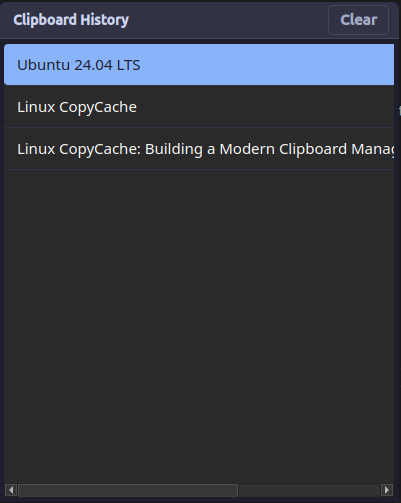

# Linux Clipboard Manager

A lightweight, local-only clipboard manager for Linux built with Python and PyQt6.


## Features
- Background daemon to monitor clipboard history.
- Popup GUI to browse and search previous items.
- Auto-paste integration with `xdotool` (X11) or `wtype` (Wayland).

## Prerequisites
- **Python 3**
- **xdotool** (for X11 users) or **wtype** (for Wayland users)

You can install `wtype` or `xdotool` on Ubuntu using:
```bash
sudo apt install xdotool wtype
```

## Installation
You can install the Clipboard Manager easily via `pip`:
```bash
pip install linux-copycache
```

### System Dependencies
The auto-pasting functionality requires `xdotool` and `xclip` to be installed on your system. The GUI requires `libxcb-cursor0`.
```bash
sudo apt install xdotool xclip libxcb-cursor0
```

## Running the tool
Once installed, you can start the application from anywhere in your terminal:
```bash
linux-copycache
```
The application will launch, dock itself to your system tray, and quietly monitor your copied text!

> **Note on PATH:** If you installed as a normal user, `pip` might place the executable in `~/.local/bin`. If your terminal says `command not found`, add this directory to your PATH:
> `echo 'export PATH="$HOME/.local/bin:$PATH"' >> ~/.bashrc && source ~/.bashrc`

## Autostart on Boot (Ubuntu/Linux)
To make the clipboard manager start automatically when you log in, create a `.desktop` file in your autostart folder.

Run this command in your terminal:
```bash
mkdir -p ~/.config/autostart && cat << 'EOF' > ~/.config/autostart/linux-copycache.desktop
[Desktop Entry]
Type=Application
Exec=linux-copycache
Hidden=false
NoDisplay=false
X-GNOME-Autostart-enabled=true
Name=Linux CopyCache
Comment=Linux Clipboard Manager
EOF
```
*(If `linux-copycache` is not in your system PATH, replace `Exec=linux-copycache` with the full path, e.g., `Exec=/home/YOUR_USERNAME/.local/bin/linux-copycache`)*

## Setting up the `Super+V` (Win+V) Shortcut in Ubuntu
For the native Windows experience, set up a custom shortcut:
1. Open **Settings** -> **Keyboard**.
2. Scroll to the bottom and click **View and Customize Shortcuts**.
3. Select **Custom Shortcuts** and click the **+** or **Add Shortcut** button.
4. **Name:** `Clipboard Manager`
5. **Command:** `linux-copycache`
6. **Shortcut:** Press `Super + V` (Windows key + V).
7. Click **Add**.

Now, whenever you press `Super + V`, the history window will pop up!
